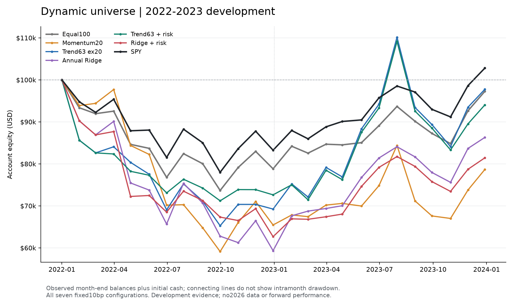

# v17 动态股票池研究：十个固定配置完成，没有达标候选

2026-10-02。**没有值得升级的策略候选。** 同口径下表现最好的预算内方案是SPY控制，净年化仅+1.39%、回撤22.16%；五个选股候选全都亏损且回撤超过30%。本轮不是通过更多训练找到了盈利模型，而是用真实历史动态池与共同执行确认了三条当前路线的失败。三次20bp成本检查也已完成，SPY控制年化+1.26%、回撤22.27%；最低回撤的选股风险组在20bp为−4.02%年化、33.49%回撤，仅保留失败诊断，不包装成获胜模型。

## 完整主比较

区间为2022—2023完整两年开发历史，初始$100,000、单边10bp、零现金利息、整股、原生Equity订单及公司行动、月度决定、下一开盘减仓/再下一开盘增仓、同一末次清仓。常规事前预算90%；两条风险组仅把SPY低于当时200日均线时的预算降至45%。没有杠杆、卖空、额外止损或阈值扫描。

|配置|末值|累计|净年化|全历史回撤|2022|2023|平均仓位|费用|
|---|---:|---:|---:|---:|---:|---:|---:|---:|
|持续池等权100|$97,269.22|-2.73%|-1.38%|26.61%|-21.18%|+23.41%|74.64%|$628.45|
|SPY 90%预算|$102,799.63|+2.80%|+1.39%|22.16%|-16.75%|+23.48%|89.03%|$191.97|
|20日动量前10|$78,668.34|-21.33%|-11.31%|42.84%|-34.55%|+20.20%|83.15%|$2,753.93|
|63日趋势、跳过最近20日|$97,754.12|-2.25%|-1.13%|37.56%|-30.76%|+41.19%|84.38%|$2,407.88|
|年度Ridge前10|$86,297.53|-13.70%|-7.11%|42.23%|-40.68%|+45.47%|81.47%|$1,267.20|
|中期趋势＋45%/90%仓位|$94,037.25|-5.96%|-3.03%|32.68%|-27.38%|+29.49%|66.33%|$1,968.10|
|Ridge＋45%/90%仓位|$81,434.40|-18.57%|-9.77%|38.92%|-37.34%|+29.95%|62.86%|$1,186.37|

完整精度、波动、换手、最大单股权重与基准差值见 [results.csv](comparison/results.csv)，年度与月度分别见 [annual.csv](comparison/annual.csv)、[monthly.csv](comparison/monthly.csv)。股票池为当时Morningstar覆盖的普通股，RAW价格>$5，20个已知连续交易日成交额中位数前100；累计183个SID。三年训练暖机不计入两年资金年化，不能使用Overview包含暖机的年化替代本表。

图中为初始资金和24个真实月末权益，连接线不代表日内或月内路径。日频回撤来自已审阅云代码的501次连续收盘统计，不因跨年或换模型重置高水位；目前未下载完整日频表，不能称已本地独立重算该回撤。

## 20bp成本复核：三组全部完成

|20bp配置|末值|累计|净年化|回撤|2022|2023|平均仓位|费用|年化较10bp|
|---|---:|---:|---:|---:|---:|---:|---:|---:|---:|
|持续池等权100|$96,525.29|-3.47%|-1.75%|26.87%|-21.48%|+22.92%|74.74%|$1,255.45|-0.38pp|
|SPY 90%预算|$102,534.50|+2.53%|+1.26%|22.27%|-16.89%|+23.38%|89.06%|$377.41|-0.13pp|
|中期趋势＋45%/90%仓位|$92,123.76|-7.88%|-4.02%|33.49%|-28.07%|+28.08%|66.43%|$3,903.67|-0.99pp|

提高成本没有改变拒绝结论。趋势风险组20bp比同池等权年化低2.27个百分点、回撤高6.62个百分点；比SPY年化低5.28个百分点、回撤高11.21个百分点。它已在10bp被拒绝，20bp只是预登记的失败诊断，不是再次选优。三对信号哈希一致；整股取整及现金路径会随成本改变，因此权益差不必刚好等于原手续费增加额。

## 哪些改动有效，哪些应停止

1. **持续流动性加20日动量不足以盈利。** 仍为−11.31%年化、42.84%回撤。相较旧v15 B的结果改善同时包含选池、127交易日特征资格和引擎版本变化，不称作纯股票池收益贡献。旧结果保留。
2. **拉长趋势并跳过最近20日改善了选股结果，但没有通过风险预算。** 相对20日动量年化提高10.18个百分点、回撤下降5.28个百分点；相对同池等权年化只高0.25个百分点，回撤却高10.95个百分点。不能因为2023年+41.19%忽略两年仍亏损。
3. **动态年度Ridge没有战胜简单对照。** 相对同池等权年化低5.73个百分点、回撤高15.63个百分点；相对SPY年化低8.50个百分点、回撤高20.08个百分点。23个月平均Rank IC仅0.0153，不能把模型更复杂视为更有预测力。到此停止相同标签/特征上的容量或训练次数追加。
4. **固定SPY趋势缩仓降低了回撤，但收益代价没有被补偿。** 趋势组平均仓位84.38%→66.33%，年化下降1.90个百分点、回撤下降4.88个百分点，仍32.68%；Ridge组平均仓位81.47%→62.86%，年化下降2.66个百分点、回撤下降3.32个百分点，仍38.92%。两组预测哈希一致，Ridge完整模型参数和训练输入也一致，因此这两项是明确的仓位规则配对，不是重新换信号。停止继续微调该阈值以追平历史。

信号组共同要求当时127个有效SplitAdjusted价格点；等权仍保留当期池内历史不足的证券，未因为未来缺价剔除它们。此资格差异以及等权、SPY与前10组合的实际仓位/集中度差异，都必须保留在解释中；相同事前预算不等于相同实际风险。因此上述模型与等权比较是完整配置表现，不能把全部差值解释为纯预测alpha。所有五个研究候选均未满足30%回撤上沿，也均未达到20%净年化；没有独立验证或前瞻结果，2026仍封存。

## 失败诊断仍指出了什么

按冻结规则，没有候选满足回撤预算时，只对最低回撤的 `trend63_risk` 做20bp失败诊断，不升级它。该组只有9/24个月盈利；每月表现超过等权、超过SPY的次数都只有10/24。最差月份为2023-08 −$16,601.70（−15.21%）、2022-01 −$14,380.66（−14.38%）、2023-10 −$5,207.60（−5.88%）。不是只靠删除一个失败交易就能解释的弱势。

该组最大盈利来源为CVNA +$7,534.59、NVDA +$5,689.68、FB SID +$5,094.77、SHOP +$2,473.21、COIN +$2,063.24；前五占盈利证券毛盈总额51.65%，最大单只17.03%。最大亏损为RBLX −$4,878.69、UPST −$4,736.03、RIVN −$3,276.63、MARA −$2,619.94、MRNA −$2,448.09；前五占亏损证券毛亏总额35.77%。分母均不是净利润。最好的三个月贡献毛盈利月份金额57.93%，最差三个月占毛亏损月份金额55.73%。这些是开发归因，不是个股排除后的反事实回测；没有删除证券重算。

见 [CANDIDATE_DIAGNOSTICS.json](comparison/CANDIDATE_DIAGNOSTICS.json) 和各case的主要证券损益。缺少完整持仓区间与预测面板归档，不能凭这些摘要断言具体反转或成交延迟的因果贡献。

## 真实训练与运行身份

项目 `37249270`，QuantConnect Free Community B-MICRO，引擎 `2.5.0.0.18149`。**十个独特策略/成本配置全部完成：七个10bp主配置、三个20bp成本检查。云端共14次实际尝试，12次完成（含一次输出修复重放及一次错误参数重复），两次暖机阶段失败。****云端实际拟合6次、独特年度模型2个**：首个Ridge两次、输出修复重放两次、Ridge风险组两次。其余规则不训练；失败两次均0拟合/0订单。这六次不是六套候选模型。

|配置|backtest ID|
|---|---|
|持续池等权100|`4fca6ea5369fafbb254aa0eff1ecf236`|
|SPY 90%预算|`75894829335b6264a5dc387c92ad7625`|
|20日动量前10|`a187b2680217d44e97e6761ef51c84b8`|
|63日趋势、跳过最近20日|`feed23708e171f6e3b7674fb095a0ee9`|
|年度Ridge前10|`8853629b1527c771f1e1b44cf99bbfc3`|
|中期趋势＋45%/90%仓位|`d5dc469c4123c4d2f1e14a4450a96abe`|
|Ridge＋45%/90%仓位|`34c60a7570c87925873ca04af7dcafe7`|

|20bp配置|backtest ID|
|---|---|
|持续池等权100|`dd50202fb4a6bda82c16dd22ac71c34e`|
|SPY 90%预算|`e316c96dea9462fc38630c6c684bd128`|
|中期趋势＋45%/90%仓位|`66e7b148349396b44d27193f02e6c6e1`|

完整尝试账见 [attempt_ledger.csv](attempt_ledger.csv)。Ridge为训练内StandardScaler + Ridge(alpha=100,solver=svd)，固定8特征，下一月决策收盘之间的SplitAdjusted价格收益横截面平均名次；分红另由引擎现金记账，未在价格标签里假装包括总收益。观察日与标签终点均严格早于部署年1月1日，即便一月决定时已知道跨年标签也不纳入当年模型。

|部署年|训练行数|最后观察|最后标签终点|模型SHA256|
|---|---:|---|---|---|
|2022|3450|2021-11-01|2021-12-01|`83ffc2ee07acd8c52bc4186710d72935180cbb9d354a9222ec66e4a7494681af`|
|2023|4645|2022-11-01|2022-12-01|`148a5755c237fe26026b50bf49e00f9e04c0a19c41966910d54414a31d3e0368`|

完整均值、尺度、系数、截距、输入哈希、耗时和无警告记录在 [FITS.json](cases/ridge_cost10/FITS.json)。同预测配对核验见 [COMPARISON.json](comparison/COMPARISON.json) 与独立复核记录。所有十个独特配置源代码身份一致；未导出逐月完整股票池成员哈希，因此仅能确认共同算法、参数与累计覆盖，不能声称已逐月逐SID哈希证明相同成员。

## 数据、工程与输出边界

- 每组完整24月、501个收盘估值，现金及归因残差仅浮点量级，期末空仓且无未决订单，`gate_pass=true`。这些是工程核对，不是最终权利和到账事实证明。
- 共5813条可解析标签，6条终止端点未解决：APC(2019-08→09)、YHOO SID(2019-10→11)、CELG(2019-11→12)、WPI SID(2020-05→06)、ABMD(2022-12→2023-01)、ATVI(2023-10→11)。前四条影响部署训练可得历史；ABMD本不满足2023年成熟截止，ATVI在两个模型部署后。没有补0，仍存在只对已知端点排名的条件选择，不能称为完整无存续偏差样本。
- 例如趋势风险组有2个实际持仓缺价观察，累计相关标记市值$14,744.86、最大单次$8,267.52；前者是观察额求和，不是亏损或独立风险资本。引擎终止成交1次、金额$6,477.34、原生费用0，仍是未独立核实的终值代理。其他组对应数量/金额在各SUMMARY，不因相同数据缺口而自动归同一笔损失。分红为引擎事件现金，不是实际支付日；换股/分拆权利覆盖仍有限。
- 原始Fundamental重复输入修复仅折叠字段完全相同的重复，实际332条；有冲突仍停止。第一失败ID `199d1175e796340f958a3e96c45bdf67` 为重复SID，第二 `279bf8437f4abd7a2d5b620bdccbefde` 为云编辑器保存竞态使用旧helper；均保留原错误，未改变研究参数。
- `b429500071dead38dd40a2f87e5a3142` 原意运行SPY20，但实际引擎身份和SUMMARY均为eq20。收益、费用和其他摘要字段与已完成eq20精确相同，仅浮点归因残差相差9.095e−13美元。原捕获保留意图注解，另存 [实际身份分类](runs/attempt12_classification.json)；计为额外完成重复，不算新策略，也不冒充SPY20。只读核验器现会在注解与实际模式/成本不符时明确失败，保留真实输出；UI显示参数不等于服务端已经使用该参数；具体平台原因尚未证实，不将后续显式Build认定为已证明的故障原因。
- 原Ridge `be47f9b57e7e311484b1a1f8bd13af55` 摘要完整但较大RuntimeStats被截断。只改观测输出后重放 `8853629b1527c771f1e1b44cf99bbfc3`：56个原数值字段差0、两个模型哈希一致。旧月度记录不全，不能声称逐月新旧对齐。详见 [独立重放核验](../INDEPENDENT_CLOUD_REPEAT_CHECK.json)。
- Free限制为最多50个RuntimeStats、每值200字符、日志10KB；本代码限45字段/9KB，完整模型写普通JSON日志。实际Ridge为45字段、最长104字符、含行预留日志7423字节。未使用编码或额外服务绕过配额。官方依据：[结果](https://www.quantconnect.com/docs/v2/cloud-platform/backtesting/results)、[资源](https://www.quantconnect.com/docs/v2/cloud-platform/organizations/resources)、[Object Store](https://www.quantconnect.com/docs/v2/cloud-platform/organizations/object-store)。
- 完整预测向量和完整逐证券损益**未本地归档**，保留哈希、冻结代码、模型及聚合结果；哈希不能代替原产物。受限供应商原始行情留在云端。账户图已在代码中输出，但普通Download Results页面被浏览器工具安全规则阻断，未确认下载，停止该路径且不绕过；所以日频DD尚未独立重算。正常RuntimeStats和日志读取可用。

## 收尾状态与下一步

七组主比较与三组预登记20bp成本检查全部完成，全部研究候选拒绝；本轮停止，不追加模型、周期、阈值或相位搜索。两年已属开发数据，不是独立验证，也不能因为2023反弹就宣称长期目标达成。

当前值得保留的是可实际训练、按时间检验并公平比较的动态研究管线。盈利能力仍不足。下一轮唯一优先工作是**把同一历史动态池管线连续扩展并验收到2016—2025完整开发区间，保留足够早的暖机及成熟训练历史**；等权、SPY和本轮失败规则作为冻结对照，不继续在这两个已开发年份内寻找参数。价格标签按决策收盘到下一决策收盘，而实际持仓分两次开盘执行，存在目标与持有区间错位；它只是后续单因素假设，当前证据不能认定是失败主因，也不在本轮顺手换标签训练。固定30股的局部好结果只能生成假设，不能直接迁到新池宣布有效。

只读核验器的具体身份误归类防护及23项相关检查实际通过，证据见 [TESTS.json](TESTS.json)；它们验证实现，不代表盈利或券商联调。

复现与恢复命令见 [README.md](README.md)；完整源码和本地只读比较入口已保存，运行身份、失败尝试和限制都保留。
