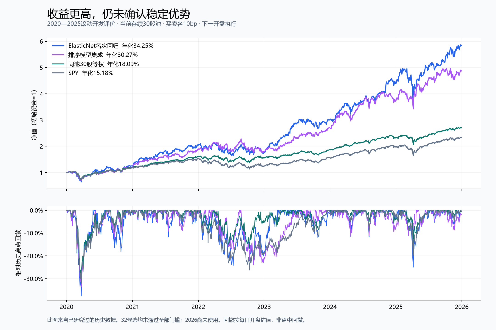

# 45分钟预算内的自主研究报告：32个候选、114次模型拟合

报告生成：2026-09-07 09:09:54 UTC。用户预算上限45分钟，本轮预算截止2026-09-07 09:26:50 UTC。研究拟合和诊断已完成；重新生成本报告只整理保存结果，不重启训练。

**结论：开发回测有明显更好的候选，但没有任何候选通过事前定义的全部门槛，因此没有证据可以把本次结果称为已验证的“质的飞跃”。2026行情仍未用于研究，未进行模拟或真实下单。**

最高开发期信息比率和年化收益来自 ElasticNet 名次回归：10bp单边成本后年化34.25%，同股票池等权18.09%，SPY 15.18%；其最大回撤-37.63%。这是一组已研究过年份、当前存续股票名单上的历史实验，不能当作未来收益预期。



## 1. 本次真正做了什么

- 沿用30只股票和SPY的2015—2025快照；实际新增13只行业、债券、风格ETF行情，共35,958条ETF日记录，每只2,766日。
- 基础22列扩展到81列，新增59列；另构造81列横截面方案。两方案合计118个不同输入列，没有把81+81误称为162个不同特征。
- 10个无需拟合的规则、19个需拟合的模型配置、3个固定集成，共32个登记候选。每个模型在2020—2025六个开发年份分别训练，**19×6=114次实际拟合**；规则计算和集成不算训练次数。
- 默认Huber与普通收益回归六年预测完全重复，所以32个候选实际有31组不同预测；没有把这个重复包装成额外进步。
- 32候选及2基准，各做10bp与20bp成本回测；另做170次调仓起始日期诊断和60次逐股禁买/匹配基准诊断，共230次附加回测。这些不是额外模型训练，也不是独立测试集。
- 保存全部模型、验证分数、开发分数、训练曲线、基于真实行情计算的逐笔回测账本、每日净值和失败门槛。全部114个模型文件均成功读取，无失败拟合记录；两次神经网络训练达到迭代上限，详见后文。

完整机器可读文件：[32个实验总表](ALL_EXPERIMENTS.csv)、[114次训练明细](ALL_TRAINING_RUNS.csv)、[逐次训练易读版](TRAINING_DETAILS.md)、[全部年度收益](ANNUAL_RETURNS.csv)。

## 2. 数据、标签与时间边界

股票池：AAPL、MSFT、NVDA、AMZN、GOOGL、META、JPM、BAC、GS、V、JNJ、PFE、MRK、UNH、XOM、CVX、COP、CAT、HON、DE、PG、KO、PEP、WMT、COST、HD、MCD、NEE、DUK、SO。

新增ETF：XLK、XLF、XLV、XLE、XLI、XLP、XLY、XLU、TLT、HYG、LQD、IWM、QQQ。全部通过缺失、重复、交易日历和基本OHLC/成交量检查，没有补造价格。静态行业代理映射不是历史GICS，GOOGL/META使用QQQ成长科技代理。HYG减LQD的历史收益差只是市场状态代理，不是纯粹信用利差。

完整股票面板82,980行。252日预热和尾部未来标签未成熟后，共同可用样本为75,240行、2,508日，2016-01-04—2025-12-22。所有特征组使用相同完整样本，避免长短特征窗口偷换评估范围。开发评分45,060行=30股×1,502观察日；这些股票日并非45,060个相互独立的样本。

标签沿用已学过的5日超额收益：

```text
调整开盘价 A = Open × Adj Close / Close
y(t) = A_股票(t+6) / A_股票(t+1) - A_SPY(t+6) / A_SPY(t+1)
```

这里两个减1抵消。特征只用t收盘及以前信息；t+1开盘进入，之后5个开盘区间在t+6退出。收益回归学习y；名次回归把同日y转成[-0.5,0.5]名次；排序树把名次转成0—4相关等级。**名次模型输出的0.1不是预测涨10%，不同目标的训练MSE不能直接比较。**

每个开发年份Y，训练使用截至Y−2年且标签已经成熟的数据，Y−1年只用于验证/提升树提前停止，然后评价Y。没有随机打散时间。训练和验证边界都按标签退出时间截断；跨开发年份的组合持仓连续计算，不丢掉年末交易。此前已经研究过2015—2025，因而本轮叫滚动开发评价，不能冒充从未看过的最终测试。

| 开发年 | 扩展训练行数 | 近3年训练行数 | 验证行数 | 开发评分行数 | 训练最晚标签退出 | 验证最晚标签退出 |
| --- | --- | --- | --- | --- | --- | --- |
| 2020 | 22440 | 22440 | 7380 | 7590 | 2018-12-31 | 2019-12-31 |
| 2021 | 30000 | 22440 | 7410 | 7560 | 2019-12-31 | 2020-12-31 |
| 2022 | 37590 | 22500 | 7380 | 7530 | 2020-12-31 | 2021-12-31 |
| 2023 | 45150 | 22530 | 7350 | 7500 | 2021-12-31 | 2022-12-30 |
| 2024 | 52680 | 22500 | 7320 | 7560 | 2022-12-30 | 2023-12-29 |
| 2025 | 60180 | 22410 | 7380 | 7320 | 2023-12-29 | 2024-12-31 |

2020年完整训练历史只有2016—2018，因此当年m13=m15、m22=m24；后续训练窗口才真正不同。验证数据按前一年滚动；前一开发年在下一轮成为验证年，是时间顺序模拟的一部分，绝不是六个完全独立实验。

## 3. 全部候选：改变什么、为什么

base=22列；extended=81列；cs=37列股票特征同日名次+44列共同市场状态。完整列名与公式在[data/processed/research_panel_v1.json](../../processed/research_panel_v1.json)。

| 编号 | 方法 | 特征组 | 训练目标 | 训练窗口 | 检验的问题 |
| --- | --- | --- | --- | --- | --- |
| r01_momentum20 | 20日动量 | — | 无需训练 | — | 过去20日涨幅较高者是否延续强势 |
| r02_momentum60 | 60日动量 | — | 无需训练 | — | 延长观察窗口，减少短期噪声 |
| r03_momentum12_skip1 | 长期动量，跳过近月 | — | 无需训练 | — | 用252日前至21日前的收益，分开长期趋势与近期反转 |
| r04_reversal1 | 1日反转 | — | 无需训练 | — | 最近1日跌得多者是否短期反弹 |
| r05_reversal5 | 5日反转 | — | 无需训练 | — | 最近5日跌得多者是否反弹 |
| r06_reversal10 | 10日反转 | — | 无需训练 | — | 延长反转信号的观察窗口 |
| r07_low_volatility | 低波动 | — | 无需训练 | — | 较低历史波动能否改善收益风险表现 |
| r08_sector_momentum | 相对行业代理动量 | — | 无需训练 | — | 选过去20日跑赢自身行业代理者，并非选最强行业 |
| r09_residual_reversal | 市场残差反转 | — | 无需训练 | — | 扣除估计市场暴露后的5日弱势是否反弹 |
| r10_momentum_lowvol | 动量加低波动 | — | 无需训练 | — | 60日动量百分位减去20日波动百分位 |
| m11_ridge_return_base | 岭回归预测收益 | base | 超额收益 | 历史扩展 | 22列基础特征，直接预测5日超额收益 |
| m12_ridge_rank_base | 岭回归预测名次 | base | 连续名次 | 历史扩展 | 保持22列，把目标换成同日横截面名次 |
| m13_ridge_rank_extended | 扩展特征岭回归 | extended | 连续名次 | 历史扩展 | 81列行业、市场状态和长期走势能否增加信息 |
| m14_ridge_rank_cs | 横截面特征岭回归 | cs | 连续名次 | 历史扩展 | 把股票特征换成同日名次，降低极端尺度影响 |
| m15_ridge_recent3 | 近3年岭回归 | extended | 连续名次 | 最近3年 | 减少陈旧训练样本，适应市场变化 |
| m16_elastic_rank | ElasticNet名次回归 | extended | 连续名次 | 历史扩展 | L1/L2正则压缩冗余特征权重，保持模型可解释 |
| m17_extra_trees | ExtraTrees | extended | 连续名次 | 历史扩展 | 检验随机化非线性树及交互是否有效 |
| m18_lgb_return | LightGBM收益回归 | extended | 超额收益 | 历史扩展 | 用提升树预测收益幅度 |
| m19_lgb_huber | 默认Huber收益回归 | extended | 超额收益 | 历史扩展 | 尝试降低大误差影响；实际默认阈值过大，结果与m18重复 |
| m20_lgb_rank_target | LightGBM名次回归 | extended | 连续名次 | 历史扩展 | 回归连续名次，而非收益幅度 |
| m21_ranker_base | 基础特征排序树 | base | 0—4相关等级 | 历史扩展 | 22列特征，直接优化同日股票排序 |
| m22_ranker_extended | 扩展特征排序树 | extended | 0—4相关等级 | 历史扩展 | 排序树中加入81列扩展信息 |
| m23_ranker_cs | 横截面特征排序树 | cs | 0—4相关等级 | 历史扩展 | 用同日特征名次表达相对位置 |
| m24_ranker_recent3 | 近3年排序树 | extended | 0—4相关等级 | 最近3年 | 只用最近3年训练排序模型 |
| m25_ranker_timeweight | 时间衰减排序树 | extended | 0—4相关等级 | 历史扩展，2年半衰期 | 旧样本权重按2年半衰期衰减 |
| m26_ranker_capacity63 | 63叶排序树 | extended | 0—4相关等级 | 历史扩展 | 把31叶增为63叶，检验增加容量 |
| m27_small_mlp | 小型神经网络 | extended | 连续名次 | 历史扩展 | 32/16两个隐藏层，测试平滑非线性组合 |
| e28_model_ensemble | 不同模型集成 | — | 无需训练 | — | m13、m17、m22评分先转同日名次，再等权组合 |
| e29_rule_model_ensemble | 规则与模型集成 | — | 无需训练 | — | 0.5*m22 + 0.25*r05 + 0.25*r02的名次分数组合 |
| e30_ranker_ensemble | 排序模型集成 | — | 无需训练 | — | m22、m23、m24的名次分数等权组合 |
| f31_huber_1pp | Huber阈值1个百分点 | extended | 超额收益 | 历史扩展 | 将阈值设为0.01，产生有效鲁棒损失对照 |
| f32_huber_3pp | Huber阈值3个百分点 | extended | 超额收益 | 历史扩展 | 将阈值设为0.03，与1个百分点阈值比较 |

固定超参数：岭回归alpha=100；ElasticNet alpha=0.001、l1_ratio=0.15、最多2000次迭代；ExtraTrees 128棵树、最大深度12、叶子至少100条、max_features=0.7。小型MLP隐藏层32/16、alpha=1、batch=1024、最多100次；不随机切出提前停止验证集。

LightGBM最多1000轮、学习率0.03、31叶（m26为63）、叶子至少100条、L2=10、列采样0.9，固定随机种子42；验证NDCG@5连续50轮无改善即停止。排序目标是LambdaRank，等级增益为[0,1,2,3,4]。这是一组有意限制规模的对照，没有穷举超参数。

每个线性模型和MLP的StandardScaler只在对应训练集拟合。集成先把各模型分数转同日名次再合成，避免把不同单位的原始分数直接相加；组合比例预先固定。

共同市场状态在同一天对30只股票都相同。在线性加法模型里，这些公共项本身不会改变当天股票排序；行业差异、股票自身变量以及交互项才会产生横截面差别。不能把“加入债券ETF”直接解释成模型已经理解宏观因果。

## 4. 同一交易规则下的全部结果

只做多，每5个交易日选择分数前5名，扣费后各20%仓位；首个观察日2020-01-02、首次入场2020-01-03、最终退出2025-12-30。301个持有期、1,506个开盘估值日。相同分数按股票代码字母顺序处理。允许碎股，无杠杆。

交易费假设为买入和卖出金额分别收取10bp（0.10%），压力测试为20bp；这是统一研究假设，不能等同于IBKR真实费率或可实现滑点。按持仓涨跌后的实际净买卖金额收费，含首建仓、末清仓。全池等权在相同日程再平衡；SPY单资产持有，主要是首尾交易费。

调整开盘价用于供应商历史总收益代理，并非可成交报价，也没有独立现金分红账本。最大回撤由逐日开盘净值计算，能看到持有期内部变化，但不包含盘中最深跌幅。没有模拟冲击、停牌后成交、限价、碎股约束或税费。

IR=日主动收益均值/标准差×sqrt(252)，主动收益以同池等权为对照；Rank IC=每日全池预测名次与真实5日收益名次的Spearman相关，再跨日平均。CAGR为几何年化收益。回撤负数越接近0越小。表中全部收益已扣假设交易费。

| 候选 | 10bp年化 | 最大回撤 | IR | 平均Rank IC | 20bp年化 | 未过门槛 |
| --- | --- | --- | --- | --- | --- | --- |
| 同池等权 | 18.09% | -31.44% | — | — | 17.91% | 对照 |
| SPY | 15.18% | -32.05% | — | — | 15.14% | 对照 |
| r01_momentum20 | 19.96% | -30.12% | 0.173 | -0.0009 | 14.96% | 年化优势; IR; Rank IC; 20bp成本; 联合置信下界 |
| r02_momentum60 | 22.51% | -29.94% | 0.298 | -0.0051 | 19.32% | IR; Rank IC; 联合置信下界 |
| r03_momentum12_skip1 | 27.21% | -31.03% | 0.531 | 0.0253 | 25.41% | Rank IC; 联合置信下界 |
| r04_reversal1 | 7.22% | -38.54% | -0.454 | 0.0064 | -0.90% | 年化优势; IR; 正超额年份; 回撤; Rank IC; 20bp成本; 联合置信下界 |
| r05_reversal5 | 9.10% | -40.45% | -0.402 | 0.0039 | 0.39% | 年化优势; IR; 正超额年份; 回撤; Rank IC; 20bp成本; 联合置信下界 |
| r06_reversal10 | 21.55% | -44.54% | 0.296 | 0.0085 | 14.31% | IR; 回撤; Rank IC; 20bp成本; 联合置信下界 |
| r07_low_volatility | 7.66% | -22.93% | -0.733 | -0.0349 | 4.51% | 年化优势; IR; 正超额年份; Rank IC; 20bp成本; 联合置信下界 |
| r08_sector_momentum | 20.15% | -34.25% | 0.206 | -0.0038 | 15.26% | 年化优势; IR; 正超额年份; Rank IC; 20bp成本; 联合置信下界 |
| r09_residual_reversal | 9.84% | -41.34% | -0.384 | 0.0001 | 1.07% | 年化优势; IR; 正超额年份; 回撤; Rank IC; 20bp成本; 联合置信下界 |
| r10_momentum_lowvol | 10.65% | -24.27% | -0.526 | -0.0161 | 7.12% | 年化优势; IR; 正超额年份; Rank IC; 20bp成本; 联合置信下界 |
| m11_ridge_return_base | 29.03% | -33.92% | 0.658 | 0.0176 | 21.48% | Rank IC; 联合置信下界 |
| m12_ridge_rank_base | 31.92% | -30.77% | 0.774 | 0.0235 | 24.61% | Rank IC; 联合置信下界 |
| m13_ridge_rank_extended | 29.68% | -38.89% | 0.687 | 0.0236 | 23.58% | 回撤; Rank IC; 联合置信下界 |
| m14_ridge_rank_cs | 24.51% | -43.13% | 0.452 | 0.0267 | 18.05% | IR; 正超额年份; 回撤; Rank IC; 联合置信下界 |
| m15_ridge_recent3 | 21.46% | -38.89% | 0.304 | 0.0097 | 15.81% | IR; 回撤; Rank IC; 20bp成本; 联合置信下界 |
| m16_elastic_rank | 34.25% | -37.63% | 0.888 | 0.0258 | 27.97% | 回撤; Rank IC; 联合置信下界 |
| m17_extra_trees | 25.19% | -33.51% | 0.499 | 0.0319 | 19.99% | IR; 联合置信下界 |
| m18_lgb_return | 18.80% | -40.28% | 0.130 | 0.0020 | 13.67% | 年化优势; IR; 正超额年份; 回撤; Rank IC; 20bp成本; 联合置信下界 |
| m19_lgb_huber | 18.80% | -40.28% | 0.130 | 0.0020 | 13.67% | 年化优势; IR; 正超额年份; 回撤; Rank IC; 20bp成本; 联合置信下界 |
| m20_lgb_rank_target | 17.11% | -37.85% | 0.056 | 0.0035 | 11.20% | 年化优势; IR; 正超额年份; 回撤; Rank IC; 20bp成本; 联合置信下界 |
| m21_ranker_base | 30.75% | -32.55% | 0.806 | 0.0258 | 24.48% | Rank IC; 联合置信下界 |
| m22_ranker_extended | 23.76% | -35.84% | 0.412 | 0.0343 | 18.18% | IR; 联合置信下界 |
| m23_ranker_cs | 21.78% | -29.00% | 0.325 | 0.0154 | 16.16% | IR; Rank IC; 20bp成本; 联合置信下界 |
| m24_ranker_recent3 | 26.36% | -35.84% | 0.602 | 0.0384 | 20.25% | 联合置信下界 |
| m25_ranker_timeweight | 12.29% | -32.93% | -0.229 | 0.0240 | 6.72% | 年化优势; IR; 正超额年份; Rank IC; 20bp成本; 联合置信下界 |
| m26_ranker_capacity63 | 24.17% | -33.96% | 0.448 | 0.0217 | 17.61% | IR; Rank IC; 20bp成本; 联合置信下界 |
| m27_small_mlp | 17.48% | -36.50% | 0.088 | 0.0185 | 11.36% | 年化优势; IR; 正超额年份; Rank IC; 20bp成本; 联合置信下界 |
| e28_model_ensemble | 31.06% | -37.57% | 0.788 | 0.0369 | 25.46% | 回撤; 联合置信下界 |
| e29_rule_model_ensemble | 15.59% | -35.25% | -0.034 | 0.0265 | 9.69% | 年化优势; IR; 正超额年份; Rank IC; 20bp成本; 联合置信下界 |
| e30_ranker_ensemble | 30.27% | -33.61% | 0.770 | 0.0373 | 24.05% | 联合置信下界 |
| f31_huber_1pp | 15.03% | -40.51% | -0.068 | 0.0222 | 9.21% | 年化优势; IR; 正超额年份; 回撤; Rank IC; 20bp成本; 联合置信下界 |
| f32_huber_3pp | 19.18% | -36.54% | 0.178 | 0.0081 | 12.68% | 年化优势; IR; Rank IC; 20bp成本; 联合置信下界 |

不能把最后一列当作行业统一标准。本轮在看结果前定义：年化超过两个基准中较高者3个百分点以上、IR≥0.5、至少4/6年超额为正、回撤不比较差基准再差5个百分点、IC≥0.03且至少4年为正、20bp仍胜同池等权，以及联合置信下界为正。门槛偏保守，是防止“不断尝试直到碰巧漂亮”的研究约束。

共同20日循环区块bootstrap做2,000次、种子20260907，32候选共用抽样日期，保留候选相关性。使用max-t一侧95%同时下界，本次临界值2.861875。**32个候选的下界全部没有超过0**；这表示本次设计不足以确认稳定优势，不等于已经证明它们全部无效。它也不能消除先前研究尝试、存续偏差或市场状态变化。

两个Huber补充是在看到首批训练诊断后登记的追加实验。把它们纳入32候选联合筛选，并不意味着本轮完全没有自适应选择。

ElasticNet在收益、IR、正超额年份和20bp压力测试上通过，但回撤、平均IC、联合下界三项未过。排序集成e30和近3年排序m24通过其余门槛，仅联合下界未过。不会为了宣布突破而事后放宽门槛。

## 5. 年份、日程与个股集中度

年度收益使用当年末净值/上年末净值−1；第一年分母为初始资金1，首尾费用保留。各年是这段模拟期间内的日历年收益，2025于12月30日开盘结束。

| 年份 | 同池等权 | SPY | ElasticNet | 基础岭回归名次 | 排序集成 | 近3年排序 |
| --- | --- | --- | --- | --- | --- | --- |
| 2020 | 18.72% | 17.81% | 24.89% | 63.84% | 20.66% | 16.74% |
| 2021 | 35.48% | 29.64% | 63.56% | 46.75% | 57.19% | 35.13% |
| 2022 | -3.18% | -18.67% | -14.97% | -26.20% | -6.22% | 6.60% |
| 2023 | 20.01% | 27.08% | 72.90% | 34.06% | 53.22% | 39.87% |
| 2024 | 24.10% | 25.39% | 46.99% | 51.45% | 37.10% | 33.22% |
| 2025 | 16.73% | 17.79% | 32.27% | 45.93% | 30.50% | 29.64% |

ElasticNet有5/6年跑赢同池等权，2022年落后11.79个百分点；它的2023年超额为52.88个百分点。单看六年平均会遮住这种差异。

固定模型与评分不动，将第一次观察日向后移0/1/2/3/4个交易日，再各自每5日调仓。每种日程都重新生成匹配基准；下表单位pp=百分点，完整32候选见[相位汇总](robustness/phase_summary.csv)。不根据结果选择最佳日程。

| 候选 | 最小年化差 | 中位年化差 | 最大年化差 | 胜同池等权相位 | 最差回撤 |
| --- | --- | --- | --- | --- | --- |
| r03_momentum12_skip1 | 9.12 pp | 10.06 pp | 11.37 pp | 5/5 | -32.66% |
| m12_ridge_rank_base | 5.23 pp | 9.20 pp | 13.83 pp | 5/5 | -39.34% |
| m16_elastic_rank | 8.02 pp | 12.44 pp | 16.17 pp | 5/5 | -37.63% |
| m21_ranker_base | 3.72 pp | 4.91 pp | 12.66 pp | 5/5 | -37.57% |
| m24_ranker_recent3 | 0.23 pp | 8.28 pp | 12.06 pp | 5/5 | -40.51% |
| e30_ranker_ensemble | 5.73 pp | 8.66 pp | 12.18 pp | 5/5 | -38.39% |

ElasticNet五种日程均胜等权，但原日程恰好是其五种中的最高收益。这仍是同一历史数据的敏感性检查，不是五次独立证实。

另对最高开发IR的ElasticNet，逐一禁止买入一只股票，保留原模型与评分，以对应29股等权为对照。30种限制后均高于各自等权；禁买NVDA影响最大：年化降到20.72%，相对29股等权优势仅4.68个百分点，回撤扩大到-42.36%。这表明NVDA贡献很重要，但并非唯一来源。这个检查没有把NVDA从训练与特征中去掉，不能叫“剔除NVDA重训验证”。[全部30种限制与基准](robustness/leave_one_out_metrics.csv)

## 6. 训练过程中的真实问题与修正

**Huber尺度。** 默认alpha=0.9对应90个百分点量级的残差阈值；当前收益标签是小数，因此默认Huber实际与普通L2的六年预测完全相同。先记录这一事实，再登记0.01和0.03两个补充阈值，实际拟合12次，最后纳入32候选共同筛选。补充结果没有成为最好方案。阈值实现见[LightGBM官方源代码](https://github.com/lightgbm-org/LightGBM/blob/main/src/objective/regression_objective.hpp)。

**CSV无损重读。** 补充评价第一次默认读取原分数时，约1e−16的解析差异改变了r10/e28/e29/e30的近同分排序，年化数值随之漂移。原模型和分数没有重训。新18脚本以float_precision='round_trip'重读原分数，保存到final_evaluation；原30全部10bp/20bp指标和排名指标恢复至绝对误差≤1e−12，32分数保存后逐位重现。不能为消除这个问题随意把评分四舍五入，那会另改策略定义。

**神经网络训练限制。** MLP实际迭代为100/100/93/77/65/62；前两年触及100次上限，优化未收敛警告已保存。后四年按训练损失停止，没有随机使用开发年提前停止。这次小网络结果不优于主要基线；不能据此下结论“所有神经网络都无效”。

原102次训练捕获了警告：100次无警告、2次MLP未收敛。补充12次Huber脚本没有捕获警告字段，明细明确标unavailable，不能写成确认无警告。模型保存和读取成功，也不代表模型具有预测优势。

## 7. 检查证据与未解决问题

特征截断在2024-06-28后重新计算，历史118列和成熟标签保持一致；手工核对正常日和拆股附近样本。它检查了本地计算的未来泄漏，不能证明供应商历史快照是当年可获得的版本。

独立从m22的2,184笔研究交易、初始现金1与原始调整开盘价重建301期/1,506日净值，最大差8.19e−13；首尾费用、下一开盘执行、每5交易日调仓、漂移持仓等权和清仓通过。另有7个明确虚构的小测试核对费用、持有期回撤和缺数据行为。[账本检查](independent_backtest_review.md)

独立实现复算32候选收益、回撤、IR、年度超额和Rank IC；bootstrap采用不同计算实现，联合下界最大误差1.52e−17。[评价检查](independent_evaluation_review.md)

当前主要限制仍是：今天选择的30只存续股造成股票池偏差；没有历史成分和退市覆盖；2015—2025已多次研究；5日标签相互重叠；调整行情可修订；30股池容易受强势股票影响。更多训练不会自动修复这些问题。

这次新增的是行业、利率/信用/风格的**市场价格状态**，不是公司基本面或新闻。已核对[SEC官方数据接口](https://www.sec.gov/search-filings/edgar-application-programming-interfaces)，但没有把今天最新财报回填到历史，更没有用季度截止日冒充公开日。下一轮如果引入财报，需要按当时公开且可获得时间重建数据，并单独做新增信息对照。这比再盲目加大同一批价格模型更有研究价值，但本轮未实现。

Yahoo/yfinance适合当前个人研究原型，不是完整机构级历史库；下载参数和快照哈希保留在原始目录。[yfinance接口参数](https://ranaroussi.github.io/yfinance/reference/yfinance.price_history.html)

## 8. 结果位置与复现

唯一最终32候选评价目录是 `final_evaluation/`。根目录的原30结果保留；`huber_scale_followup/`内12次模型拟合有效，但其中旧32评价受CSV解析影响，已被最终目录替代。所有报告使用最终目录，不混用旧结果。

环境沿用 `M:\ml项目\.venv\Scripts\python.exe`，Python3.12.2，yfinance1.7.0、pandas3.0.5、numpy2.5.3、scikit-learn1.9.0、LightGBM4.7.0。研究训练没有新增依赖；报告图另增加Matplotlib，锁定版本见requirements.txt。没有Git仓库，未commit/push。

在项目目录运行以下命令可用保存数据重现评价与报告；不需要登录账户：

```powershell
.\.venv\Scripts\python.exe .\18_finalize_research.py
.\.venv\Scripts\python.exe .\17_research_robustness.py
.\.venv\Scripts\python.exe .\19_collect_training_records.py
.\.venv\Scripts\python.exe .\20_write_research_report.py
.\.venv\Scripts\python.exe .\data\experiments\auto_research_45m_v1\plot_equity.py
```

14负责准备与检查数据；15是原30候选训练；16是已登记的Huber补充。15/16保留当次预算与已完成实验保护，不在原目录无意重训覆盖结果。新的研究问题应另登记实验目录。

本次停在研究结论与报告。没有候选通过留出准入，因此2026仍保留；没有接券商、没有自动模拟交易服务、没有真实交易信号或订单。后续先解释这里最有价值的差异，再决定下一类数据或一个明确的验证问题。
