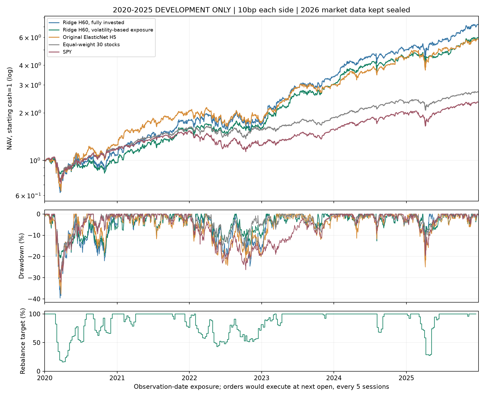

# 本轮持续研究完整汇报

本轮发现了更好的历史风险收益折中：60日相对收益名次的岭回归，配合固定波动率仓位规则，值得继续验证。它仍未达到预设的全部研究准入标准，不能称为已经获得可实盘、稳定盈利或市场最强的模型。

## 先看主要结果

以下是完全相同2020—2025开发区间、5交易日调仓、次日开盘、单边10bp费用的结果。回撤显示负数；例如-20.75%表示从历史峰值最大下跌20.75%。数据为供应商调整开盘价研究代理，不是实际账户成交。

| 方案 | 年化 | 最大回撤 | 5日Rank IC | 20bp年化 |
| --- | --- | --- | --- | --- |
| 原5日ElasticNet满仓 | 34.25% | -37.63% | 0.0258 | 27.97% |
| 60日Ridge满仓 | 39.13% | -39.60% | 0.0362 | 36.07% |
| 60日Ridge＋波动率仓位 | 34.77% | -20.75% | 0.0362 | 32.09% |
| 同池等权满仓 | 18.09% | -31.44% | — | — |
| SPY | 15.18% | -32.05% | — | — |

与原5日ElasticNet相比，新组合历史CAGR相差+0.51个百分点，最大回撤浅16.88个百分点；费用翻倍后CAGR为32.09%。这说明值得研究的进步同时来自预测周期和仓位规则，不能归功于单纯把模型做大。

仓位规则为 `min(1, 0.15 / (SPY过去20日收益标准差 × sqrt(252)))`。它只用观察日已知价格，原调仓网格的下一开盘实施；未投入部分按零息现金处理，不借款。15%是基于SPY的缩放参数，不保证股票组合实际波动率等于15%，也不是止损价格。实际目标之间会发生价格漂移。

## 为什么还没有启用交易

最终联合98条目中，**0/98通过全部门槛**。该岭回归＋仓位规则通过收益、IR、年度一致性、回撤、Rank IC和20bp压力检查，但未通过共同多重尝试校正后的主动收益置信下界：日主动收益同时下界为-0.000176，未大于0。这个置信判断无法证明它没有价值，也不足以证明优势稳定存在。

主筛选对比满仓同池等权与SPY；同样仓位规则的等权基准另列，用于区分选股和风险控制的作用，主门槛沿用预登记设置。2015—2025被多轮研究过，98列也包括重复控制；区块bootstrap不能消除全部历史反复尝试或存续股票池偏差。2026行情仍未读取。

本机IBKR检查仍为not_connected：默认本机候选端口没有可用连接，未完成API握手或paper身份确认。没有真实或券商模拟订单发送，没有启用常驻自动下单服务。未来券商模拟成交与实际成交也存在差异，见[IBKR官方paper说明](https://www.interactivebrokers.com/docs/tws-api/doc/notes-limitations/limitations/paper-trading)。

## 这轮实际做过的训练和策略

| 环节 | 已完成工作 | 记录 |
| --- | --- | --- |
| 多周期模型 | Ridge、ElasticNet、LambdaRank；H=5/20/60；基础22、价格81、加财务97、加事件125列的24配置；每配置6年度，共144次拟合 | [24组完整对照](MODEL_COMPARISON.md)、[144次训练明细](TRAINING_DETAILS.md) |
| 组合比较 | 每个模型top5/top10，48条新主策略，分别10/20bp；联合旧44条目，共92条 | [48条新策略](comparison_new48.csv)、[92条表](comparison_all92.csv) |
| 持有周期诊断 | 固定ElasticNet full H20/H60、top5/top10，各匹配H调仓及自身基准 | [持有期结果](holding_diagnostics/comparison.csv) |
| 风险控制 | 原ElasticNet H5与新Ridge H60，分别波动率规则、200日趋势规则、两者组合，共6变体，联合评价扩为98条 | [风险6条](../risk_controls_v4/comparison_new6.csv)、[最终98条](../risk_controls_v4/comparison_all98.csv) |
| 更早历史 | 重新取得2012—2025连续快照，固定上述两模型在2016—2025逐年拟合，共20次；满仓/波动率仓位诊断 | [20次训练明细](../extended_history_v5/TRAINING_DETAILS.md)、[完整结果](../extended_history_v5/comparison.csv) |

本轮合计164次实际模型拟合；144次中的24次是旧控制重现。更早历史20次使用新的训练样本，未计作控制重现。此前两批自动研究150次，加本轮共314次，包含重复控制，不包括更早教学脚本。当前两批新拟合均无训练警告；模型数量不能代替有效信息量或验证质量。

输入中的财报事件来自SEC已保存事实：财务同比变化、真正推进报告期间的新申报、距申报的交易日数和修改申报。只用filed早于观察日的事实；没有把财季截止日当作可知日期。数据来源与限制参见[SEC API说明](https://www.sec.gov/search-filings/edgar-application-programming-interfaces)。本轮主矩阵9组price/full成对对照的统一5日IC均未因加全套财报事件而改善；ElasticNet内部单独加事件在H5有小幅回升，在H20/H60下降。完整失败项保留，不能因此推断所有基本面或新闻都无用。

## 全部6组仓位实验

vol15是上述波动率规则；trend25在SPY调整收盘低于过去200日均值时降到25%股票目标仓位，否则100%；combined取两者乘积。参数先固定，没有搜索最好的阈值。与模型无关的同风险等权也使用同一规则。

| candidate | cagr | max_drawdown | stress_cagr | matched_risk_equal_cagr | IR_vs_matched_risk_equal | gate_all |
| --- | --- | --- | --- | --- | --- | --- |
| v4_ridge_h60_price_top5_vol15 | 34.77% | -20.75% | 32.09% | 14.87% | 1.1913 | False |
| v4_ridge_h60_price_top5_trend25 | 31.09% | -26.05% | 28.51% | 13.70% | 1.0582 | False |
| v4_elastic_h5_price_top5_vol15 | 29.45% | -19.80% | 24.22% | 14.87% | 0.9421 | False |
| v4_ridge_h60_price_top5_combined | 30.14% | -22.69% | 27.71% | 12.50% | 1.1665 | False |
| v4_elastic_h5_price_top5_trend25 | 26.17% | -24.15% | 21.14% | 13.70% | 0.8318 | False |
| v4_elastic_h5_price_top5_combined | 24.98% | -16.87% | 20.39% | 12.50% | 0.8917 | False |

## 更多历史给出的约束

已获取44份连续价格文件。共同原始日历从2012-05-18开始，共3425日；META此前没有返回记录，不补历史价格。252日预热后，可用面板95,010行、3167日，从2013-05-22至2025-12-22。

2016—2025的逐年连续评分为75,240行/2508日。下表的年数是在10个日历年中战胜“同一仓位规则的等权基准”的数量。没有将这张较长历史表加入98条冠军选择，也没有用它替换失败的门槛。

| candidate | cagr | max_drawdown | mean_rank_ic | IR_vs_matched_equal | positive_active_years_out_of_10 |
| --- | --- | --- | --- | --- | --- |
| equal_full_cost10 | 19.37% | -31.34% | — | — | — |
| equal_vol15_cost10 | 16.16% | -20.02% | — | — | — |
| spy_full_cost10 | 14.96% | -32.05% | — | — | — |
| ridge_h60_price_full_cost10 | 30.36% | -33.08% | 0.0346 | 0.6985 | 7 |
| ridge_h60_price_vol15_cost10 | 27.46% | -27.12% | 0.0346 | 0.8119 | 7 |
| elastic_h5_price_full_cost10 | 25.53% | -33.58% | 0.0274 | 0.4606 | 8 |
| elastic_h5_price_vol15_cost10 | 21.53% | -25.20% | 0.0274 | 0.4522 | 7 |
| equal_full_cost20 | 19.22% | -31.36% | — | — | — |
| equal_vol15_cost20 | 15.88% | -20.08% | — | — | — |
| spy_full_cost20 | 14.93% | -32.05% | — | — | — |
| ridge_h60_price_full_cost20 | 27.49% | -33.94% | 0.0346 | 0.5648 | 7 |
| ridge_h60_price_vol15_cost20 | 24.82% | -28.00% | 0.0346 | 0.6715 | 7 |
| elastic_h5_price_full_cost20 | 19.98% | -34.32% | 0.0274 | 0.1741 | 5 |
| elastic_h5_price_vol15_cost20 | 16.72% | -26.51% | 0.0274 | 0.1618 | 5 |

该实验使用更早训练样本、新连续供应商快照和更早锚定的调仓日程，不能把收益差异单独归因于数据量；原快照未覆盖或拼接改写。重叠历史价格差异记录在snapshot_overlap.csv。2016—2019此前曾用于旧模型训练，这次逐年重训诊断也不能称全新、从未接触的测试。

## 稳定性诊断和局限

Ridge H60满仓的5个调仓起点CAGR范围为30.61%—41.42%，没有选最高相位去替换原计划。禁止交易NVDA但不重训后，CAGR为23.88%、最大回撤-41.32%；同一29股等权为16.04%。说明原成绩受个别强势股票影响，需要继续检查，不等于已做完删除该股后的模型重训。

目前仍是今天选出的30只存续股票、静态行业ETF代理、供应商可修订的调整价格；缺少完整历史股票池和退市覆盖。回撤是每日开盘代理估值，不是盘中极值。没有真实成交滑点/冲击校准、实际拆股/分红现金账本、市场一致预期或最早业绩新闻。新增财报列并不自动产生可交易的预测信息。

## 检查与执行准备

- 22,978条财报来源引用匹配原始SEC事实；全30股物理截断重算、缺失标记与期间匹配检查通过；9,000组标签价格端点检查通过。
- 144份主模型和20份扩展历史模型的哈希、特征顺序、训练边界、仅训练集标准化和恢复评分检查通过。CSV评分均无损保存/读取。
- 32项虚构数据/故障测试通过：旧离线回放、IBKR只读响应、订单生命周期和股票/现金仓位账本。它们不是券商真实成交证据。
- 历史离线回放再次运行新增成交0，原42笔虚拟成交未重复。当前订单状态原型区分未知提交、部分成交、重复ID、撤单竞争、恢复核对和成交更正；没有网络下单功能，外部事务持久化、佣金处理和真实重连适配器仍待集成。
- requirements.txt保存实际虚拟环境；ib_async 2.1.0可导入，pip check通过。其依赖将tzdata固定到2025.3，本轮实际日历和历史重算已验证。

## 下一步的研究重点

当前候选保留为研究用途。优先补充更可靠的历史股票池/退市和公告时点数据，检验预测是否在更广样本和新的未来时期持续成立；不要再靠扩大网络或不断搜索阈值换取一条好曲线。执行方向已有只读探测和离线测试，下一工程节点是经过身份核验的券商模拟联调，独立检验成交、持仓与现金账本。自动实盘不由某张回测表自动开启。

详细模型解释、标签、费用与重现命令见[主研究报告](RESEARCH_REPORT.md)。更早历史运行35/36，汇总运行37；所有完整结果均已保存，重跑不会自动开启2026行情或券商订单。
