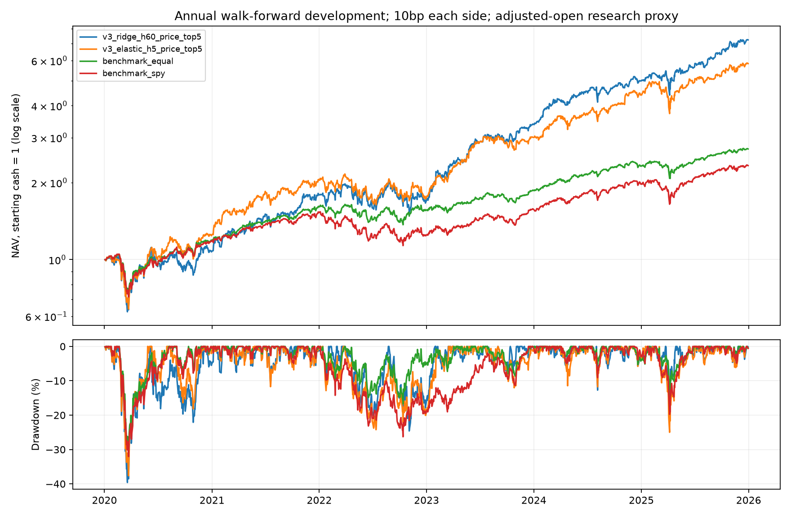
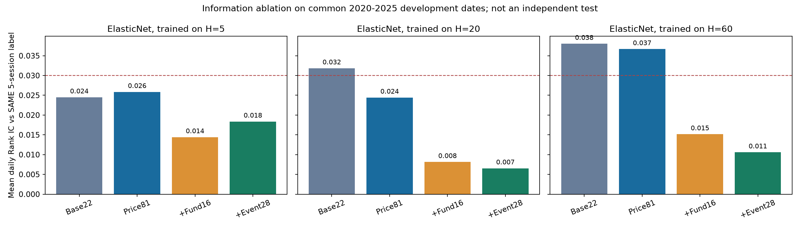

# 第三轮连续研究：预测周期、财报事件和执行准备

尚无条目通过全部既定研究门槛，2026行情保持封存，不能据此声称策略取得质的飞跃。

本轮上限为2026-09-09 05:03:07—07:03:07 UTC，中途用户恢复后沿用原预算；最终完成时间另见session_completion.json。训练截止06:45:07 UTC。这里报告实际完成的工作，不把预算当作已经运行的时长。

## 实际训练了什么

24个配置×2020—2025六个年度，共144次实际拟合，保存全部模型、逐次记录、验证评分、开发评分和排序树学习曲线。其中24次直接复现旧控制；累计前三轮拟合为294次，包含重复控制。此次训练调用耗时合计13.65分钟，不等同于总墙钟时间。存在警告的拟合数：0，原文保留在训练明细。

三个预测周期为5、20、60交易日。Ridge alpha=100；ElasticNet alpha=.001、l1_ratio=.15；LambdaRank最多1000轮、31叶、按各自H的验证NDCG提前停止。固定随机种子42，不在开发年上挑超参数。输入分别为基础22列、价格/ETF81列、加财务水平后的97列、再加本次事件后的125列。18个主矩阵配置加6个ElasticNet输入消融。

每个年度训练使用Y-2及以前，验证使用Y-1，评分使用Y；训练/验证标签各自的退出日期必须严格早于下一段。填补和标准化只在训练行拟合。价格、成交量、波动率、行业/债券ETF状态以外，本轮加入财务同比变化、报告公开后的交易日计时和修改申报事件。SEC来源说明见[官方API文档](https://www.sec.gov/search-filings/edgar-application-programming-interfaces)。

股票池仍是30只今天选定的存续股票，原始行情2015—2025；没有把增加标签或财报列称为新增股票行情。训练共同面板75,240行，开发评分45,060行/1,502日，2020-01-02—2025-12-22。

## 结果口径与主要比较

所有48个主策略都每5个交易日调仓，次日开盘成交，top5/top10等权、只做多、无杠杆。单边10bp=成交金额的0.10%，20bp压力测试=0.20%；费用按实际净买卖金额收取，包含初建仓、最终清仓。不同预测H没有改变主交易日程。2015—2025已经反复用于开发，年度向前验证不使这些年份重新变成独立测试。

同池等权CAGR 18.09%、最大回撤-31.44%；SPY CAGR 15.18%、最大回撤-32.05%。这些都是特定历史、固定成本和调整开盘价代理下的研究结果，不是实际账户收益。

本轮按IR最高的开发条目为 `v3_ridge_h60_price_top5`：CAGR 39.13%，最大回撤-39.60%，IR 1.038，统一5日Rank IC 0.0362。是否通过全部门槛：False。不能只看它的最高历史收益宣布最强。

| candidate | cagr | max_drawdown | information_ratio | mean_rank_ic | stress_cagr | gate_all |
| --- | --- | --- | --- | --- | --- | --- |
| v3_ridge_h60_price_top5 | 39.13% | -39.60% | 1.0378 | 0.0362 | 36.07% | False |
| v3_elastic_h60_price_top5 | 36.84% | -39.77% | 0.9469 | 0.0367 | 33.83% | False |
| v3_elastic_h5_price_top5 | 34.25% | -37.63% | 0.8884 | 0.0258 | 27.97% | False |
| v3_elastic_h60_fund_top5 | 33.42% | -39.10% | 0.8560 | 0.0152 | 30.85% | False |
| v3_elastic_h5_base_top5 | 32.97% | -30.77% | 0.8215 | 0.0245 | 25.63% | False |
| v3_elastic_h60_base_top10 | 28.23% | -36.82% | 0.8175 | 0.0380 | 25.88% | False |
| v3_elastic_h20_base_top5 | 33.26% | -36.75% | 0.8138 | 0.0318 | 29.54% | False |
| v3_elastic_h60_base_top5 | 33.40% | -38.05% | 0.8008 | 0.0380 | 30.04% | False |
| v3_elastic_h5_fund_top5 | 29.84% | -35.54% | 0.7145 | 0.0144 | 24.23% | False |
| v3_ridge_h5_price_top5 | 29.68% | -38.89% | 0.6866 | 0.0236 | 23.58% | False |
| v3_elastic_h20_base_top10 | 25.35% | -36.75% | 0.6415 | 0.0318 | 22.59% | False |
| v3_ridge_h20_price_top5 | 29.27% | -38.86% | 0.6406 | 0.0242 | 25.55% | False |



全部24组模型对照见[MODEL_COMPARISON.md](MODEL_COMPARISON.md)，全部48条新策略和92条联合结果见comparison_new48.csv、comparison_all92.csv。它们包含重复控制，不能称92个独立策略。逐年主动收益、每条门槛、同时下界均在CSV中，不只展示胜者。

## 更多信息是否有效

下面用ElasticNet四层输入进行成对比较；新增信息对统一5日交易IC的影响可以直接比较。Ridge/排序树本轮只有price与full，不能独立归因财务水平或事件的贡献。



| kind | horizon | contrast | IC5_delta | CAGR_delta | drawdown_delta |
| --- | --- | --- | --- | --- | --- |
| ridge | 5 | full_minus_price | -0.0059 | -6.10% | 0.90% |
| elastic | 5 | full_minus_price | -0.0075 | -8.01% | -0.76% |
| ranker | 5 | full_minus_price | -0.0186 | -9.52% | 0.23% |
| elastic | 5 | price_minus_base | 0.0014 | 1.28% | -6.86% |
| elastic | 5 | fund_minus_price | -0.0114 | -4.41% | 2.09% |
| elastic | 5 | full_minus_fund | 0.0040 | -3.60% | -2.86% |
| ridge | 20 | full_minus_price | -0.0187 | -9.49% | 3.01% |
| elastic | 20 | full_minus_price | -0.0179 | -9.48% | 2.19% |
| ranker | 20 | full_minus_price | -0.0119 | -1.53% | 11.72% |
| elastic | 20 | price_minus_base | -0.0074 | -5.19% | -4.12% |
| elastic | 20 | fund_minus_price | -0.0163 | 0.07% | 1.29% |
| elastic | 20 | full_minus_fund | -0.0016 | -9.54% | 0.90% |
| ridge | 60 | full_minus_price | -0.0260 | -16.72% | -1.05% |
| elastic | 60 | full_minus_price | -0.0261 | -14.32% | -0.88% |
| ranker | 60 | full_minus_price | -0.0233 | -6.14% | 6.04% |
| elastic | 60 | price_minus_base | -0.0014 | 3.43% | -1.72% |
| elastic | 60 | fund_minus_price | -0.0215 | -3.42% | 0.67% |
| elastic | 60 | full_minus_fund | -0.0046 | -10.90% | -1.55% |

CAGR_delta和drawdown_delta为比例之差，阅读时用百分点；回撤差为正表示回撤较浅。对应结论仅限这组样本、特征定义和固定参数。财报公开事件并不等于最早的业绩新闻，也没有包含市场一致预期和真实业绩惊喜。不能由某组财报输入失效推断所有基本面或新闻都没有价值。

## 长周期标签与低频交易的区别

本征IC按模型训练的H计算；主门槛仍用共同5日IC。各H成熟日期如下，尾部未来尚未发生的标签不补值，但仍允许仅用X评分。共同成熟日期的本征IC单列在模型表中；长周期重叠标签不是独立样本。

| horizon | sample | rows | dates | first_observation | last_observation | last_exit |
| --- | --- | --- | --- | --- | --- | --- |
| 5 | all_horizons_mature | 43410 | 1447 | 2020-01-02 | 2025-10-03 | 2025-10-13 |
| 20 | all_horizons_mature | 43410 | 1447 | 2020-01-02 | 2025-10-03 | 2025-11-03 |
| 60 | all_horizons_mature | 43410 | 1447 | 2020-01-02 | 2025-10-03 | 2025-12-31 |
| 5 | native_mature | 45060 | 1502 | 2020-01-02 | 2025-12-22 | 2025-12-31 |
| 20 | native_mature | 44610 | 1487 | 2020-01-02 | 2025-12-01 | 2025-12-31 |
| 60 | native_mature | 43410 | 1447 | 2020-01-02 | 2025-10-03 | 2025-12-31 |

预先固定的4个持有H日诊断（各含10/20bp）如下。每行使用自身相同日程的等权/SPY基准；不参加92条目冠军选择。

| candidate | cost_bps | cagr | max_drawdown | period_count | matched_equal_cagr | matched_spy_cagr |
| --- | --- | --- | --- | --- | --- | --- |
| v3_elastic_h20_full_top5_hold20_cost10 | 10.0 | 23.83% | -38.46% | 75 | 18.15% | 15.14% |
| v3_elastic_h20_full_top10_hold20_cost10 | 10.0 | 20.11% | -37.41% | 75 | 18.15% | 15.14% |
| v3_elastic_h20_full_top5_hold20_cost20 | 20.0 | 22.57% | -38.59% | 75 | 18.04% | 15.10% |
| v3_elastic_h20_full_top10_hold20_cost20 | 20.0 | 19.02% | -37.51% | 75 | 18.04% | 15.10% |
| v3_elastic_h60_full_top5_hold60_cost10 | 10.0 | 34.11% | -40.60% | 25 | 18.73% | 15.14% |
| v3_elastic_h60_full_top10_hold60_cost10 | 10.0 | 27.67% | -34.69% | 25 | 18.73% | 15.14% |
| v3_elastic_h60_full_top5_hold60_cost20 | 20.0 | 33.48% | -40.65% | 25 | 18.65% | 15.10% |
| v3_elastic_h60_full_top10_hold60_cost20 | 20.0 | 27.22% | -34.69% | 25 | 18.65% | 15.10% |

## 如何处理多次尝试与不稳定性

联合92条目使用相同日期、20交易日循环区块bootstrap、2,000次共同重采样、seed20260907。max-t一侧95%同时下界检验的是相对同池等权的日主动收益均值。它考虑此列族的共同尝试与相关性，不能消除此前自适应研究、存续股票池和行情修订偏差。

各单项通过数量：

| gate | passes_in_92 |
| --- | --- |
| gate_cagr | 59 |
| gate_information_ratio | 38 |
| gate_positive_years | 65 |
| gate_drawdown | 48 |
| gate_rank_ic | 17 |
| gate_stress | 53 |
| gate_simultaneous_ci | 0 |

调仓起点五种相位、30bp、禁止选NVDA但不重训、逐股P&L贡献及5/20/60日bootstrap区块敏感性保存在robustness目录。诊断不反过来更换最好的日程或放宽门槛。

## 检查证据

- 事件数据75,420行，22,978条来源引用匹配SEC原始事实，财务变化和事件时钟各527,940个单元格重算一致，缺失标记完整。
- 全30股过去日期物理截断重算通过；9,000个价格端点核对通过。filed严格早于观察日；不是按财季截止日提前使用财报。
- 144份保存模型复核哈希、特征顺序、各H训练/验证边界、训练中位数/均值/方差、预测恢复与排序树早停位置。完整性：True。
- 所有评分CSV用round_trip读取，保存前后逐值相同；旧控制在1e-12内复现，避免极小浮点漂移改变排序并列。

## 向自动交易推进了什么

真实本机IBKR探测结果：`not_connected`，paper身份确认：False，订单发送：0。阻塞项：`no_local_candidate_tcp_listener`。目前没有可用TWS/IBGateway API会话；没有伪装成已连通的模拟交易。使用的ib_async 2.1.0是第三方Python客户端；ib_async依赖约束使tzdata从2026.3变为2025.3，requirements.txt已保存实际环境，pip check通过。历史保存日期与本轮标签端点复核通过。

新增只读就绪脚本29_check_ibkr_readiness.py，核对本机监听、API握手、账户身份、服务器时间、仓位和开放订单快照；账户标识和金额脱敏，超时保持未知。端口或readonly参数本身不证明paper身份。连接要求参考[IBKR官方说明](https://www.interactivebrokers.com/docs/tws-api/doc/connectivity/establishing-an-api-connection)。

订单状态原型execution_order_state.py处理提交不确定、部分成交、重复回报、撤单与迟到成交、恢复核对和成交更正隔离。全部是虚构事件的离线测试，不是真实券商认证；没有网络下单方法，也尚未整合外部事务日志、佣金账本和重连适配器。IBKR可能重复发送状态，成交更正ID也有特殊规则，分别依据[订单状态说明](https://www.interactivebrokers.com/docs/tws-api/doc/order-management/order-status/introduction)和[ExecID说明](https://www.interactivebrokers.com/docs/tws-api/doc/order-management/execution-details/exec-id-behavior)。

旧历史回放闭环保留；真实行情刷新、成交价格/分红账本、市场冲击、账户级资金限制和券商模拟运行仍待贯通。当前没有启用真实订单或常驻自动服务。即使之后接通paper，模拟成交也不能代替实盘成交验证，见[IBKR paper差异](https://www.interactivebrokers.com/docs/tws-api/doc/notes-limitations/limitations/paper-trading)。

## 文件与复现

项目解释器为 `M:\ml项目\.venv\Scripts\python.exe`。

```powershell
.\.venv\Scripts\python.exe 28_train_multihorizon.py
.\.venv\Scripts\python.exe 30_validate_research_inputs.py
.\.venv\Scripts\python.exe 30_validate_research_inputs.py --fits
.\.venv\Scripts\python.exe 31_research_robustness_v3.py
.\.venv\Scripts\python.exe 32_write_multihorizon_report.py
.\.venv\Scripts\python.exe -m unittest discover -s tests -v
.\.venv\Scripts\python.exe 29_check_ibkr_readiness.py
```

28发现完整结果后不重复训练。输入准备26/27复用已有SEC和价格快照；绝不自动下载2026或发送订单。新实验必须使用新目录和登记设计，不能覆盖这次结果；原始时间预算不会被重跑延长。

关键记录：DESIGN.md、plan.json、TRAINING_DETAILS.md、training_log.jsonl、各年份joblib/评分/curve、INPUT_CHECKS.json、FIT_CHECKS.json、backtests逐笔交易/逐期/逐日文件、robustness诊断和session_completion.json。
