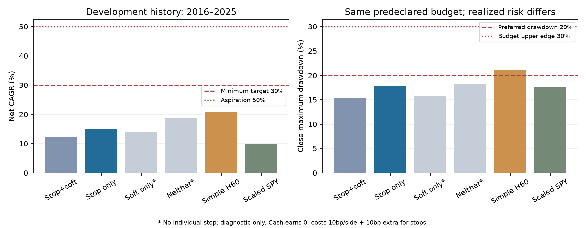

# H60风控修复、固定比较与模拟执行：本轮完整报告

结论：两项确认的代码问题已修复，39次固定历史重放完成。主候选未达到扣费长期CAGR至少30%的收益目标，也没有胜过同一事前风险预算下的简单H60，**拒绝升级，不使用2026终测**。此次不存在“完全放心”或已证明稳定盈利的自动交易模型。

报告生成：2026-09-09T09:09:20.166611+00:00。基线提交`9d98008d72f096c2c1fa33a998f000fe62c48bb5`；当前修改保存在本地，代码身份以每文件SHA256记录。无新增训练、行情下载或真实账户订单。

## 1. 修复及真实历史影响

`daily_risk_reduce`现在调用只卖函数：按当前报价计算目标，再以已有持仓金额逐股封顶，费用从实际卖出额计算，所得留现金。昨日权重变化不再成为买入指令，已止损退出的零持仓不会重新开仓。v6/v7均已修复。虚构跳空回归与实际历史重放分别保留，不能相互替代。

`risk_inputs(..., policy.target_vol)`已接通，0.15默认值与原公式一致，改变参数确实改变仓位。公式`min(1, target_vol / SPY过去20日年化波动)`只调市场代理仓位，不承诺股票组合实现15%波动。软减仓、硬暂停是独立配置；v7原排名12保留缓冲、软恢复和冷却后的趋势/网格复仓继续保留。

同一原H60预测、普通成本10bp下的旧/新结果：

| 同一H60的配置 | 非计划买单旧→新 | CAGR旧→新 | CAGR差(百分点) | 收盘回撤旧→新 | 年双向换手旧→新 |
| --- | --- | --- | --- | --- | --- |
| v7_allocation | 281 → 0 | 18.875% → 18.872% | -0.0029 | -18.159% → -18.159% | 7.857 → 7.845 |
| v7_stops | 244 → 0 | 14.605% → 14.881% | +0.2756 | -17.750% → -17.739% | 10.112 → 10.045 |
| v7_full | 99 → 0 | 11.320% → 12.155% | +0.8352 | -15.366% → -15.366% | 8.267 → 8.298 |
| v6_allocation | 1886 → 0 | 13.269% → 13.272% | +0.0028 | -21.014% → -21.013% | 7.150 → 7.092 |
| v6_full | 1378 → 0 | 6.051% → 6.049% | -0.0024 | -14.912% → -14.900% | 11.609 → 11.568 |

这里的v6是单H60修复对照，不是重算H20/H60集成。未调用17/18旧路径，也未重算百分位集成；对应旧问题保留为已知事项。v7完整规则CAGR由11.32%到12.16%，是此次历史路径上的实际影响；“没有错误买单”本身不保证收益提高，v6完整对照变化就很小。完整买入金额、累计收益和差值见[bug_impact.csv](bug_impact.csv)。

## 2. 固定比较与验收

[运行前计划](PLAN.md)与[机器计划/输入哈希](plan.json)在模拟前登记。唯一主候选为“止损开／软减仓关”；4格仅开关个股止损和软减仓，20%硬暂停及其余v7参数不变。无止损两格只作诊断，不替换成最终策略。

简单H60与SPY都使用事前固定80%总仓位上限、同一SPY波动缩仓和20%硬暂停/冷却/恢复，不根据全期结果调整仓位。80%来自原12%计划损失预算/15%保护距离。它们的集中度和实现波动不同：这叫相同事前预算，**不叫事后波动完全匹配**。简单H60基准回撤21.15%处于用户允许的20%—30%上沿档，主候选回撤17.74%在优先档；两者都须另外满足收益要求。

统一2016-01-05—2025-12-29；初始权益1对应10,000 USD，收盘权益、零息现金、无杠杆、调整OHLC/碎股研究代理。全部含首次建仓和最终开盘清仓成本。普通成本每边10/20bp，触发止损另加10bp滑点。换手为买卖金额之和/前一收盘权益，再按实际年数平均，包含末次退出；不是只计单边换手。费用列按初始10,000 USD缩放，是整个区间累计金额，不是每年收益拖累。

| 固定配置／单边成本 | 累计净收益 | CAGR | 收盘最大回撤 | 年化波动 | 平均股票仓位 | 年双向换手 | 累计普通费用($) | 累计止损滑点($) |
| --- | --- | --- | --- | --- | --- | --- | --- | --- |
| 个股止损开／软减仓开／10bp | 214.27% | 12.16% | -15.37% | 10.20% | 57.52% | 8.30x | 1,578.58 | 156.33 |
| 个股止损开／软减仓关（主候选）／10bp | 299.39% | 14.88% | -17.74% | 12.59% | 69.77% | 10.05x | 2,103.35 | 227.92 |
| 个股止损关／软减仓开（诊断）／10bp | 268.36% | 13.95% | -15.65% | 11.43% | 61.95% | 7.20x | 1,484.71 | 0.00 |
| 个股止损关／软减仓关（诊断）／10bp | 461.65% | 18.87% | -18.16% | 13.51% | 70.95% | 7.84x | 1,993.95 | 0.00 |
| 简单H60／80%预算／10bp | 560.93% | 20.83% | -21.15% | 15.76% | 70.51% | 16.69x | 4,822.90 | 0.00 |
| SPY／80%预算／10bp | 153.11% | 9.75% | -17.57% | 10.66% | 71.48% | 1.52x | 242.81 | 0.00 |
| 个股止损开／软减仓开／20bp | 189.54% | 11.24% | -15.32% | 10.14% | 57.33% | 8.28x | 3,031.81 | 148.98 |
| 个股止损开／软减仓关（主候选）／20bp | 261.23% | 13.73% | -18.63% | 12.61% | 69.77% | 10.04x | 3,962.93 | 214.40 |
| 个股止损关／软减仓开（诊断）／20bp | 261.54% | 13.74% | -15.80% | 11.33% | 61.54% | 7.11x | 2,907.78 | 0.00 |
| 个股止损关／软减仓关（诊断）／20bp | 419.33% | 17.94% | -18.32% | 13.52% | 70.95% | 7.84x | 3,796.32 | 0.00 |
| 简单H60／80%预算／20bp | 462.17% | 18.88% | -21.69% | 15.78% | 70.49% | 16.68x | 8,691.25 | 0.00 |
| SPY／80%预算／20bp | 149.30% | 9.58% | -17.62% | 10.66% | 71.48% | 1.52x | 481.46 | 0.00 |

原100%仓位上限H60背景对照：CAGR 27.46%、累计1026.64%、收盘回撤-27.69%；满仓SPY背景：14.96%/-33.72%。它们不混充同预算对照。当前固定比较没有方案同时达到30%长期净CAGR及不超过30%回撤；没有降低标准或增加杠杆。

## 3. 保护措施的收益代价与年度表现

保留15%个股保护、单独关闭10%软减仓，CAGR从12.16%增至14.88%，增加2.73个百分点；回撤由-15.37%加深至-17.74%。这支持“软减仓在这段历史拖累盈利”的局部假设，但不足以达标。

在软减仓关闭时，个股保护开/关的CAGR分别为14.88%/18.87%，净差-3.99个百分点；回撤分别为-17.74%/-18.16%。不据此把正式候选换为无止损；四格显示规则存在交互，不能把各条逐笔结果简单相加。

| 主候选直接执行原因 | 订单条数 | 买单数 | 累计交易额($) | 普通费用($) |
| --- | --- | --- | --- | --- |
| daily_cap | 466 | 0 | 6,714.57 | 6.71 |
| final_liquidation | 8 | 0 | 32,097.49 | 32.10 |
| scheduled | 4331 | 2266 | 1,836,847.94 | 1,836.85 |
| stop_gap | 33 | 0 | 49,276.17 | 49.28 |
| stop_intraday | 113 | 0 | 178,412.59 | 178.41 |

计划调仓的目标本身可能包含SPY缩仓、软状态或恢复期影响；直接订单原因不是纯因果归属。`cap_and_soft`保留联合标记，不随意分摊。软规则的总影响用上述成对消融衡量。完整12条对照的原因明细在[trade_reason_summary.csv](trade_reason_summary.csv)，逐笔交易/现金/股数与每日权益均通过核对。

主候选基准硬暂停触发0次，个股退出146次，其中开盘跳空33次。基准没有触发某规则，不等于它失效或没有必要；高成本/延迟压力和虚构故障另检验其路径。

止损后股票路径（事后描述）：

| 观察窗口 | 有效退出数 | 平均后续价格变化 | 中位后续价格变化 | 后续价格高于退出代理价比例 |
| --- | --- | --- | --- | --- |
| 5交易日 | 146 | 2.23% | 2.49% | 63.01% |
| 20交易日 | 146 | 5.92% | 5.72% | 69.86% |
| 60交易日 | 144 | 12.60% | 13.93% | 75.69% |

这些收益从止损代理成交价到随后股票收盘价计算，仅使用原快照中可见到2025年末的后续记录；尾部不足窗口的样本不补值。反弹并不等于取消止损后的组合收益，因为现金、替代持仓、权重和后续退出都改变。

每个自然年的实际净收益如下，不要求各年都达到30%；不是挑最好年份：

| year | 个股止损开／软减仓开 | 个股止损开／软减仓关（主候选） | 个股止损关／软减仓开（诊断） | 个股止损关／软减仓关（诊断） | 简单H60／80%预算 | SPY／80%预算 |
| --- | --- | --- | --- | --- | --- | --- |
| 2016 | 25.23% | 25.23% | 26.90% | 26.90% | 32.48% | 9.21% |
| 2017 | 31.12% | 31.12% | 33.13% | 33.13% | 33.52% | 17.05% |
| 2018 | -5.65% | -9.63% | -2.40% | -2.97% | -10.48% | -3.78% |
| 2019 | 10.95% | 20.77% | 11.36% | 26.60% | 30.01% | 19.89% |
| 2020 | -7.17% | -4.99% | -8.44% | -5.18% | -5.51% | 3.45% |
| 2021 | 22.90% | 30.66% | 28.82% | 35.19% | 53.59% | 21.18% |
| 2022 | -5.50% | -3.03% | -8.16% | -2.55% | -7.24% | -11.52% |
| 2023 | 27.84% | 31.99% | 31.80% | 38.79% | 59.35% | 18.99% |
| 2024 | 17.23% | 17.23% | 24.24% | 24.24% | 26.15% | 18.07% |
| 2025 | 13.15% | 19.66% | 13.09% | 25.65% | 18.65% | 10.15% |

[annual_results.csv](annual_results.csv)同时保留39条结果的年波动、年内回撤及全历史回撤。年内回撤重置仅供描述，不替代全账户历史回撤。

## 4. 固定压力，未选最优相位

| 场景 | CAGR | 累计净收益 | 收盘最大回撤 | 硬暂停次数 |
| --- | --- | --- | --- | --- |
| stress_cost30_stop50_candidate | 11.29% | 190.84% | -25.70% | 1 |
| stress_cost30_stop50_simple_h60 | 17.24% | 389.17% | -20.44% | 1 |
| stress_cost30_stop50_simple_spy | 9.42% | 145.55% | -17.67% | 0 |
| stress_delayed_next_open_candidate | 14.26% | 278.25% | -17.85% | 0 |
| stress_delayed_next_open_simple_h60 | 18.88% | 462.17% | -21.69% | 1 |
| stress_delayed_next_open_simple_spy | 9.58% | 149.30% | -17.62% | 0 |
| stress_phase1_candidate | 15.26% | 312.62% | -16.86% | 0 |
| stress_phase1_simple_h60 | 24.41% | 784.19% | -19.85% | 0 |
| stress_phase1_simple_spy | 10.12% | 161.64% | -15.34% | 0 |
| stress_phase4_candidate | 16.64% | 363.64% | -16.93% | 0 |
| stress_phase4_simple_h60 | 23.80% | 739.56% | -19.22% | 0 |
| stress_phase4_simple_spy | 9.57% | 148.69% | -16.78% | 0 |
| stress_exclude_NVDA_candidate | 11.97% | 209.05% | -21.91% | 1 |
| stress_exclude_NVDA_simple_h60 | 13.76% | 262.13% | -22.48% | 1 |
| stress_exclude_NVDA_simple_spy | 9.75% | 153.11% | -17.57% | 0 |

高成本为普通30bp/止损额外50bp；延迟为触发后的下一开盘、普通20bp/额外50bp；相位只核对预定1和4；禁NVDA只限制交易，不重训。SPY不持NVDA也没有个股止损，对应相同输出仍完整列出。没有从相位中挑一个作为新的主策略。

主候选高成本压力回撤达到25.70%，超过约20%的优先目标但仍在30%预算上沿内；20%触发线不是成交/最大回撤保证。成本可改变暂停时点、恢复周期和后续持仓，结果不必单调。全部有限压力净累计收益为正且回撤在30%以内，仍不能抵消基础收益门槛失败。

## 5. 训练、执行和2026的真实状态

- 实际新增训练 **0次**。复用2016—2025十份年度H60 Ridge对应的原保存预测；模型alpha=100、solver=svd、81个原特征，哈希及实际训练/标签成熟截止见[TRAINING_RECORD.json](TRAINING_RECORD.json)。没有新模型容量、财报特征或周期搜索。
- 工程模型仅为2025年度H60，SHA256 `2c19480278678e72fb9303e4f615737abccfa2c7dac883893af36390c2365ece`。最后训练观察日2023-10-03、训练标签退出2023-12-29、验证标签退出2024-12-31；不是当前2026部署模型。
- 最新共享H60闭环：26笔**虚构成交**、57个持久化订单意图（含保护单，撤单另记事件）、16日状态重载核对。独立CLI完整重跑新增意图/成交均为0。另用3个真实操作系统进程、2次刻意中断验证超时和撤单成交竞争恢复。恢复后8股持仓对应8股保护、原买单仅提交一次。
- 真实IBKR检查时间2026-09-09T08:30:52.726916+00:00，状态`not_connected`，阻塞`no_local_candidate_tcp_listener`。真实paper订单0、真实paper成交0；前瞻业绩观测0。SDK响应测试全部虚构，不能写成联调成功。
- H60决策、目标、股数封顶和保护规则已共用；共享协调器在撤单确认后重算目标，并使用实际成交日期恢复冷却。部分建仓期间若保护成交，会撤销未成交的买入余单，核对期间继续预留资金和可卖数量。73项已有及新增测试通过，只证明其覆盖的场景。[执行说明/命令](EXECUTION_GUIDE.md)、[工程清单](ENGINEERING_STRATEGY_MANIFEST_v5.json)、[恢复记录](execution_faults_v2/completion.json)提供具体证据。
- 2026价格本轮未读取/下载/用于选择或评估。开发区间2016—2025已反复使用，不独立。本轮唯一主要候选被拒绝，只封存工程测试配置，**未冻结任何用于2026终测的候选**。原0/98未过全部统计门槛的记录保持不变。

若未来通过新的预登记开发门槛，须先冻结唯一策略、少量对照与年度更新协议：模拟2026年初时训练只能用截至2024的观察且H60标签在2025年前成熟，2025验证标签在2026年前成熟；再一次性评估未消耗的2026。报告实际累计收益和样本长度，不靠短期年化宣布30%目标达成。本轮没有执行该训练/终测路径。

## 6. 阻塞与下一步

盈利阻塞来自当前信号/组合在固定成本和约束下的净收益不足；修复错误、减少软减仓已改善一部分，但主候选14.88%仍远低于30%，连较简单的20.83%对照也未达标。下一次应检验**新的可用信息或信号能否增加扣费收益**，而不是继续调整这四格或放弃全部保护。

唯一优先工作：完成一种许可合适、含历史成分与退市处理的股票池数据闭环，再登记一次有明确信号增量假设的比较。[独立数据任务](HISTORICAL_UNIVERSE_TASK.md)记录实际可用性、接口、许可及固定30股代码需要改动的位置；增加今天仍存续的股票不算解决偏差。

工程的具体外部阻塞是本机paper会话未就绪，随后还需确认独立预算、身份、实时行情权限、数量/价格精度和公司行动。保护单撤换窗口、真实订单回报时序与长期断线历史补齐尚未通过券商验证。用户最少操作及可运行的只读检查在执行说明中；没有后台交易服务，没有真实资金执行授权。

## 复现与文件

`42_evaluate_h60_risk_fixes.py`读取原输入和本目录固定计划；完成后再次运行只核对身份并保留结果。`43_run_h60_simulation.py`默认虚构报价执行，`44_test_h60_recovery.py`默认虚构券商进程故障测试，`45_summarize_h60_v8.py`只汇总保存结果。原v5/v6/v7及m16演练不覆盖。

本目录保留全部39次日权益、交易、持仓、目标和事件，完整预测仍使用原v5 `all_scores.csv`，准确哈希在[INPUT_IDENTITY.json](INPUT_IDENTITY.json)，没有用新数据替代。新文件一览及SHA256见[ARTIFACTS.csv](ARTIFACTS.csv)。本报告的费用、收益、回撤都来自实际保存输出。
