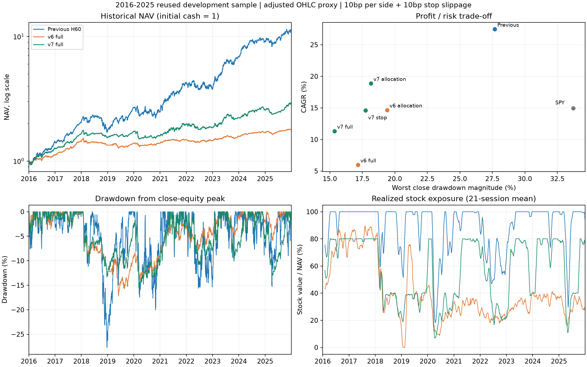

# 反思、两版新策略与执行结果

结论：已制定并实际执行两版策略，完成10次新增年度拟合和41次历史回测。两版都降低了历史回撤，但均未通过先登记的盈利要求，因此拒绝替换旧研究基线。当前没有可被证明“完全放心”、稳定盈利的全自动交易模型，没有开启券商模拟或真实下单。

## 我需要改正的地方

1. 训练次数不是有效性的证据。之前固定股票池上的多轮比较已经反复使用开发期；更大的模型和更多组合不自动带来新信息。旧模型有可继续研究的表现，但尚未满足全部统计筛选，且当前30股名单存在存续样本偏差。
2. 旧SPY波动率缩仓不是止损。此前按每日开盘估值的回撤还漏掉了收盘及盘中变化。本轮在相同价格快照、相同调仓网格、相同末次清仓日重现旧开盘NAV，再为所有对照增加一致的收盘估值。
3. 把多种风险规则相乘会牺牲持仓机会；不能把低仓位导致的浅回撤包装成更强预测。v6完整规则平均股票仓位只有40.16%；软降仓又缺乏正常恢复条件。这是本轮需要承认的设计缺陷，原结果没有被悄悄修改。
4. 模型预测相对收益，股票池一起下跌时仍会排出第一名。选股、是否持仓、损失退出和订单可靠性需要分别验证。止损可降低某些损失，也可能在暂时下跌后卖出并错过反弹；止损触发价不保证实际成交价。[FINRA官方说明](https://www.finra.org/investors/insights/stop-orders-factors-consider-during-volatile-markets)

## 同口径实际结果

区间2016-01-05至2025-12-29；普通买卖单边10bp，止损额外10bp。价格均为原Yahoo快照的调整OHLC研究代理，碎股、零息现金，无杠杆。`max_drawdown`为**收盘权益**峰值回撤，负号表示下跌。所有方案包括首次建仓和最终清仓成本。

| strategy | cagr | max_drawdown | average_gross | stop_exits |
| --- | --- | --- | --- | --- |
| 旧H60+SPY波动率仓位 | 27.46% | -27.69% | 89.34% | 0 |
| v6 集成+分散仓位 | 14.67% | -19.40% | 67.48% | 0 |
| v6 再加ATR跟踪止损 | 9.67% | -17.14% | 62.82% | 812 |
| v6 完整规则 | 5.96% | -17.16% | 40.16% | 806 |
| v7 H60+精简仓位 | 18.88% | -18.16% | 70.96% | 0 |
| v7 再加15%保护止损 | 14.61% | -17.75% | 69.79% | 148 |
| v7 完整规则 | 11.32% | -15.37% | 56.48% | 148 |
| 同池满仓等权 | 19.37% | -32.92% | 99.96% | 0 |
| SPY满仓 | 14.96% | -33.72% | 99.96% | 0 |

旧控制开盘NAV和原v5文件的最大绝对差仅5.15e-14，属于浮点运算差异。旧控制本次收盘最大回撤-27.69%，原开盘口径为-27.12%；不能把估值时点变化当成策略进步。

## v6做了什么，为什么拒绝

固定H20/H60 Ridge横截面名次各占一半；81个历史价格/ETF特征。新增H20模型按2016—2025逐年拟合10次，H60复用同快照10份模型并逐一恢复评分。Y年评分时只训练至Y-2，Y-1验证标签出场严格早于Y年；验证没有挑参数。没有2026行情输入。

每5日最多10股、保留名次15、个股10%/行业25%/大型科技群35%目标上限、60日逆波动分配、组合波动率缩仓及SPY趋势限制。个股止损为3倍14日平均真实波幅、距离限制5%—12%，逐日收盘提高次日保护线；单股/合计计划损失预算0.75%/5%。组合回撤8%降仓、12%清仓冷却。

不含止损版本年化14.67%，加入个股止损后9.67%，完整规则5.96%。新规则不能满足用户的盈利优先要求，且v6软降仓没有正常恢复，故整体拒绝。

单独控制预测这一项：相同v6仓位规则、关闭止损和组合暂停，H60单模型年化13.27%，集成年化14.67%。这才是比较模型混合影响的成对证据；不能直接用旧top5与新top10差异归因于模型。

统一5日Rank IC：H20=0.0243，H60=0.0346，集成=0.0304，简单动量=-0.0012。预测名次、具体持仓和最终账户收益仍是不同层次。

## v7的修订与最终判断

保留H60预测，最多8股，保留名次12；等权基础，个股12.5%、行业30%、大型科技群40%上限。使用原SPY波动率缩仓，不再同时叠加逆波动选股、组合波动率上限和趋势降仓。调仓时计划个股/合计止损损失预算2%/12%，目标总仓位最多80%。

止损改为入场/每5交易日计划调仓价格下方15%的保护线，只提高、不放宽，不逐日追踪峰值。组合回撤10%减半，恢复到5%以内允许在下一调仓恢复；20%清仓，经过20日冷却及市场趋势恢复后才在固定网格重启，先半仓10日。保留整个历史的真实回撤，风险周期峰值重置不抹去亏损。参数是本轮研究选择，未经用户确认为实盘风险额度。

完整v7年化11.32%、收盘最大回撤-15.37%；成本加倍年化10.38%、回撤-15.32%。它优于v6，但未达到旧方案年化80%的门槛（21.97%），且未跑赢满仓SPY。因此仍拒绝作为盈利优先的替代方案。未把无止损的高收益行偷偷换成最终策略。

完整诊断通过状态：[v6门槛](../robust_strategy_v6/diagnostic_gates.json)、[v7门槛](../profit_priority_v7/diagnostic_gates.json)。这些是风险设计诊断；此前0/98统计筛选保留，本轮后验修订不能当成新的独立终测，也没有自动进入2026验证。重复挑选历史好成绩会产生回测过拟合风险。[原研究论文](https://www.davidhbailey.com/dhbpapers/backtest-prob.pdf)

## 跳空、止损和压力结果

模型看到t日收盘，调仓在t+1开盘代理执行。生效止损若被开盘跳空穿过，按更差开盘再扣止损滑点；普通日内触价假设能在阈值附近执行，并额外计费。这个日线假设仍不能证明真实撮合、停牌后成交或市场冲击。另列触发后延迟到下一开盘的压力情形。

v6止损806次，其中跳空165次，最差跳空模拟成交比保护阈值低19.11%。v7止损148次，其中跳空33次，最差低10.47%。可见15%止损距离不是实际最大损失承诺。

事后诊断中，卖出后第5交易日收盘高于退出代理价的比例：v6 57.32%，v7 63.51%。这仅描述触发后的股票路径，不能直接等同于该次止损“做错了”或取消止损后的组合收益。

v7固定压力表：

| candidate | cagr | max_drawdown | worst_day |
| --- | --- | --- | --- |
| cost30_stop50 | 9.49% | -14.92% | -4.21% |
| delayed_next_open_cost20_stop50 | 11.02% | -14.82% | -3.25% |
| exclude_NVDA_no_retrain | 9.06% | -16.61% | -3.20% |
| phase_0 | 11.32% | -15.37% | -4.09% |
| phase_1 | 11.09% | -14.54% | -3.63% |
| phase_2 | 10.12% | -15.81% | -4.31% |
| phase_3 | 10.98% | -14.15% | -3.81% |
| phase_4 | 14.91% | -13.39% | -3.71% |

[v6完整压力表](../robust_strategy_v6/stress_comparison.csv)也全部保留。相位0—4改变交易起点；结束日固定，最后持有期可能缩短，不能当成完全相同成交样本。禁NVDA只是禁止交易、没有重训，不能替代历史股票池检验。

最终全部清仓后，按每股净现金流计算NVDA占总利润的比例：旧控制39.97%，v6 19.25%，v7 30.15%。这不是独立因果贡献，但说明降低仓位集中后，收益仍依赖个别强势股。[利润来源明细](profit_concentration.csv)

费用或延迟会改变账户回撤触发日期和后续持仓，所以压力场景的回撤不一定单调变差；更低的回撤不能解释为更高成本有利。

`low_stress_drawdown`是假设持仓同时到达各自日Low、且不享受止损保护时的悲观估值诊断。它不是实际观测到的盘中组合极值，也不是概率承诺。普通收盘回撤同样不能作为盘中最大亏损的保证。

## 验证与可靠性的实际边界

31个输入股票/基准快照哈希、完整共同日历和OHLC关系通过；物理截断后风险特征前缀完全不变；新增10份模型仅用训练集标准化，已保存H60评分精确重现。训练警告0。全部41次历史回测逐笔费用、现金变化、股份数量、最终清仓和每日权益核对通过，目标约束也逐次检查。

本轮及原项目共49项虚构行情/执行故障测试，保存结果通过=True。包括跳空穿价、触发后延迟、禁止同日重新买入、阈值不读取同日未来High、软降仓恢复、数据缺失拒绝继续、未来截断、重复成交与恢复核对。它们不是券商集成证据。

本轮没有接券商订单，没有用调整价格生成可提交券商的订单，也没有启动后台交易服务。策略状态文件记录`deploy_eligible=false`，它是研究状态记录，尚不是接到券商上的风险开关。既有IBKR只读探测和订单状态原型仍需要真实模拟账户联调。IBKR模拟撮合与真实撮合也有差异，模拟通过不能直接证明实盘执行可靠。[IBKR官方模拟限制](https://www.interactivebrokers.com/docs/tws-api/doc/notes-limitations/limitations/paper-trading)

## 接下来的策略方向

保留H60作为研究基线，保留已经检验的时间边界、成本和跳空处理；不采用本轮损害收益的整体规则。下一项研究应优先检验新增信息和信号的可交易性：历史股票池/退市、公告真实可用时间，以及模型对绝对收益和下行风险的判断。预先固定下一次比较，不为通过门槛继续放宽止损。

在可部署之前，还需要独立前瞻样本、真实报价和公司行动账本、券商模拟下的止损/部分成交/断线恢复、账户与资金损失限额。这些缺口是当前“不能完全放心”的具体原因。任何账户硬止损也是触发规则，极端跳空或停牌可能使损失超出阈值。

## 记录与重现

- [v6运行前策略](../robust_strategy_v6/DESIGN.md)、[v7运行前修订](../profit_priority_v7/DESIGN.md)
- [10次新训练明细](../robust_strategy_v6/training_summary.csv)、[v6全部16条成本对照](../robust_strategy_v6/comparison.csv)、[v7全部10条成本对照](../profit_priority_v7/comparison.csv)
- [逐日/逐笔v6输出](../robust_strategy_v6/backtests)、[逐日/逐笔v7输出](../profit_priority_v7/backtests)、[研究状态](strategy_status.json)
- 运行38新增训练，39执行v6，40执行v7，41重建本报告；已完成时保留既有模型与结果，不重新训练、不下载2026。
